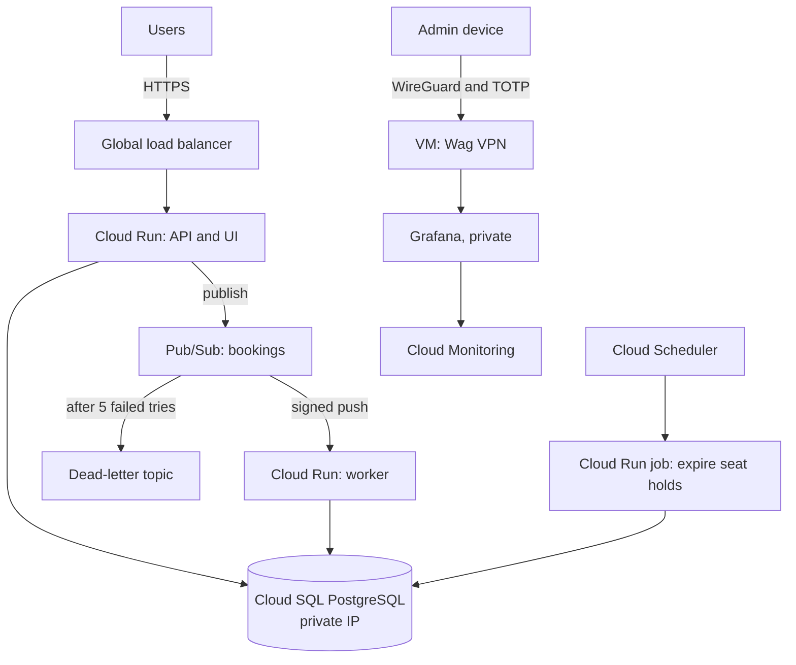

# Housefull

An event ticket booking platform on Google Cloud, built around the hardest moment for a booking site: sales open, everyone arrives at once, and no two people can get the same seat.

**Live site: https://housefull.jeneeldumasia.dev**

This is a portfolio project. Events are examples, no real tickets are sold, and no payment is taken. The app is deliberately small, because the focus is how it's deployed, secured, and run.


| Picking seats | Your tickets |
|---|---|
|  |  |

## Results

Load tested on the live site, on small Cloud Run instances and the smallest Cloud SQL database:

| Requests a second | Failed | 95% finished within |
|---:|---:|---:|
| 10 | 0 | 81 ms |
| 25 | 0 | 74 ms |
| 50 | 0 | 85 ms |
| **100** | **0** | **181 ms** |
| 200 | 3.2% | 10.2 s |
| 400 | 73.5% | 11.6 s |

- **No double-bookings.** 1,732 accepted bookings matched exactly 1,732 booked seats.
- **Past the limit,** Cloud Run refused extra traffic, and the database stayed healthy at about 50% CPU.

[Read the full load test report](docs/load-test.md) for what was tested and what it found.

## Architecture



How a booking works:

1. The API locks the seats with a database transaction, so only one person can get them.
2. It publishes a message to Pub/Sub and replies straight away.
3. A separate worker confirms the booking, and ignores repeated messages.
4. If a booking is never confirmed, a scheduled job releases the seats.

## Tech stack

| Area | Tools |
|---|---|
| App | Python, FastAPI, PostgreSQL, HTML, CSS, JavaScript |
| Google Cloud | Cloud Run, Cloud SQL, Pub/Sub, Cloud Load Balancing, Artifact Registry, Secret Manager, Cloud Scheduler, Cloud Monitoring |
| Infrastructure as Code | Terraform, HCP Terraform |
| CI/CD | GitHub Actions, Workload Identity Federation |
| Security | Trivy, Gitleaks, Wag (WireGuard with MFA), IAP |
| Monitoring and testing | Grafana, Cloud Monitoring, k6, pytest, Playwright |

## Delivery

All infrastructure changes go through pull requests, and `main` is protected.

- **Pull request:** runs the tests and a `terraform plan`, using a read-only account.
- **Merge to `main`:** runs the tests, scans the image, applies Terraform, and migrates the database. The API is then released through a 10% traffic stage, with automatic rollback if checks fail.
- **Up and Down:** manual workflows that create or destroy the app, to control cost.

## Security

- **No stored cloud keys.** GitHub Actions logs in with short-lived Workload Identity Federation credentials.
- **Private database.** Cloud SQL has no public address, and connections are encrypted.
- **Locked-down services.** The API only accepts traffic from the load balancer, and only Pub/Sub can call the worker.
- **Least access.** Each service has its own service account.
- **Application security.** Argon2 password hashing, HttpOnly session cookies, and login limits stored in PostgreSQL.
- **Private metrics.** Grafana is reachable only through [a Wag VPN](docs/vpn-access.md), with an enrolled device and a TOTP code.

## Run it locally

Needs Docker with Compose.

```bash
docker compose up -d --build
```

Open http://localhost:8080. After signing up, make your account an admin so you can create events:

```bash
docker compose exec api python -m scripts.make_admin you@example.com
```

Run the tests:

```bash
docker compose --profile test run --build --rm tests
```

## Known limits

- The database is a single small instance in one zone, so it's a single point of failure.
- Sign-ups close at 200 accounts.

## Documentation

- [Build log](docs/build-log.md): every change, the reasons behind it, and the trade-offs.
- [Load test report](docs/load-test.md)
- [VPN access](docs/vpn-access.md)
