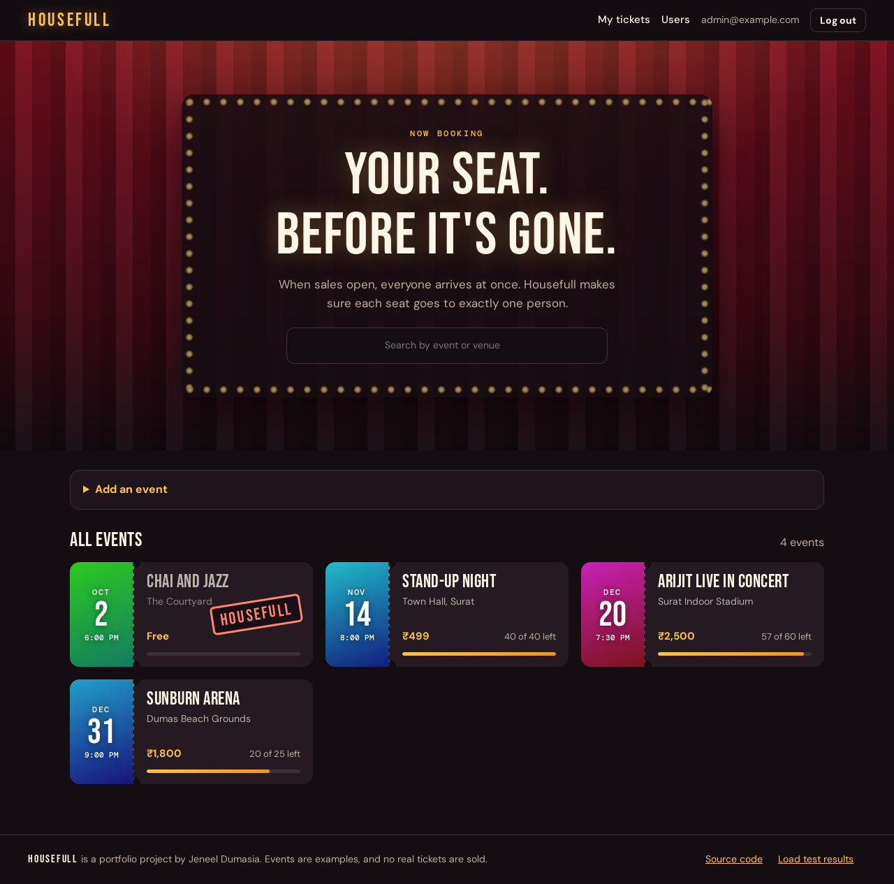
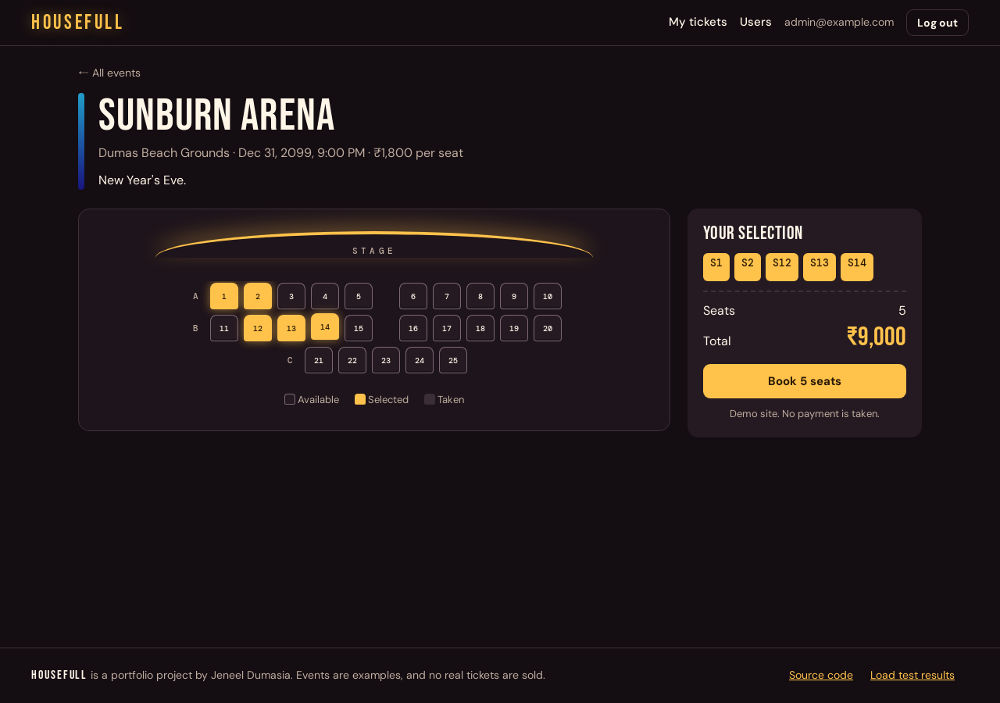
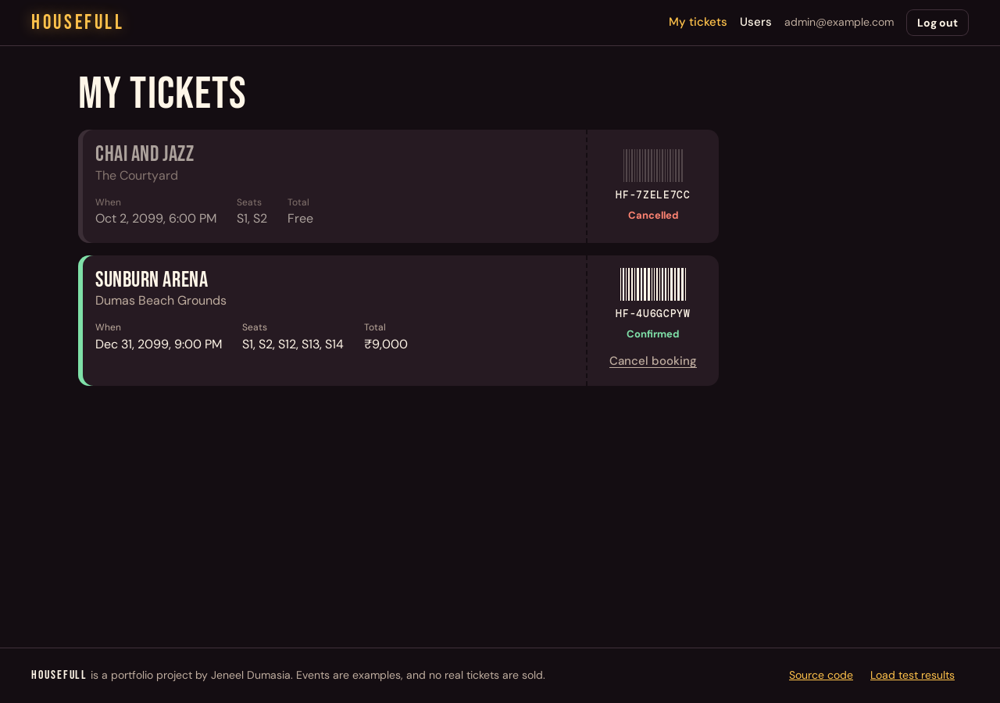

# Housefull

An event ticket booking app built to handle the rush when sales open, and to practise deploying and running a service on Google Cloud.

**Live at https://housefull.jeneeldumasia.dev**

In a load test it handled 100 requests a second with no failures, and no seat was double-booked even when pushed past its limit. See [the load test results](docs/load-test.md).

Every change and the reasons behind it are in [the build log](docs/build-log.md). Metrics are private, on Grafana behind [a Wag VPN](docs/vpn-access.md).



| Picking seats | Your tickets |
|---|---|
|  |  |

## Run it locally

Needs Docker with Compose.

```bash
docker compose up -d --build
```

Open http://localhost:8080. After signing up, make your account an admin so you can create events:

```bash
docker compose exec api python -m scripts.make_admin you@example.com
```

## Run the tests

```bash
docker compose --profile test run --rm tests
docker compose --profile test rm -sf test-db
```

## How booking works

1. The API reserves the seat with a single atomic database update, so only one person can get it.
2. The API publishes a message to Pub/Sub and replies straight away.
3. A separate worker receives the message and confirms the booking.
4. If a booking is never confirmed, a scheduled job releases the seat.
